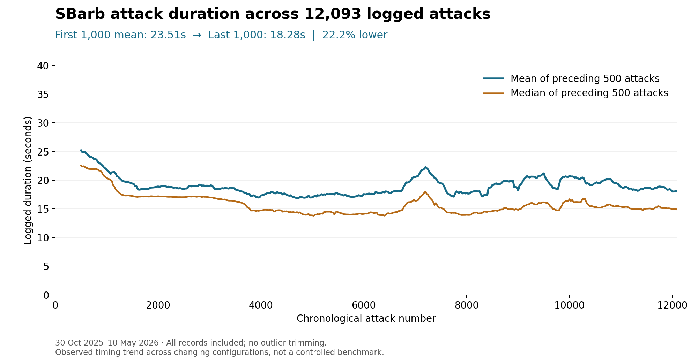
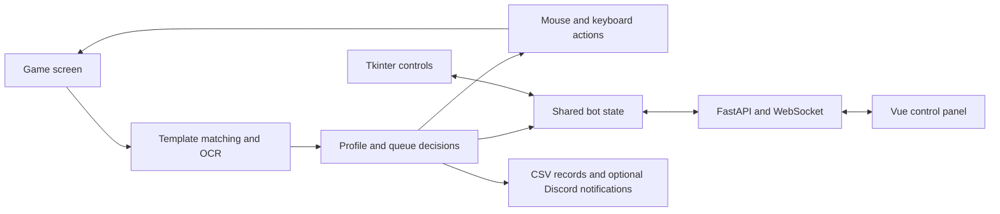

# CoC Auto Attacker

A Windows desktop automation project combining computer vision, configurable attack routines, a Tkinter interface, and a Vue/FastAPI control panel.

I built this project from scratch with AI coding assistance. It grew around automating repeated Clash of Clans tasks and making the bot's decisions visible through detection overlays, logs, and statistics.

## Results from recorded use

| Result | Evidence |
|---|---|
| **16,074 logged attacks** | 12,093 SBarb and 3,981 Builder Base Gold attacks, October 2025–May 2026 |
| **97.0% SBarb target attainment** | 4,873 of 5,023 outcome-labelled attacks, 23 January–10 May 2026 |
| **22.2% lower mean SBarb duration** | 23.51s → 18.28s, comparing the first and last 1,000 attacks |
| **31.0% lower median SBarb duration** | 21.61s → 14.90s across the same windows |

I kept timing logs as I iterated on the attack routine. Target attainment means the bot detected the configured destruction threshold; earlier records lack outcome labels. Duration covers the attack routine, excluding base search. All logged durations are included, and configurations changed during development.



The [complete attack datasets and reproduction script](docs/metrics/README.md) make these statistics reproducible. See [Attack logs and timing improvements](docs/performance.md) for outcome definitions and comparison windows. Builder Base records document use across different troop strategies and opponent strengths.

## Explore the project

- [Computer vision and Builder Base screenshots](docs/computer-vision.md)
- [Attack statistics and measurement methodology](docs/performance.md)
- [System architecture and tradeoffs](docs/architecture.md)

## What it does

The bot reads the game screen, decides whether a base meets the selected criteria, executes a configured sequence of mouse and keyboard actions, and records attack data.

- **Screen interpretation:** OpenCV template matching identifies buildings and interface elements; Tesseract OCR reads resource and trophy values.
- **Deployment geometry:** Builder Base boundary estimation using HSV masks, Hough lines, convex hulls, and perimeter sampling.
- **Attack profiles:** farming, trophy pushing, deranking, Super Goblin and Super Barbarian farming, achievement targeting, Builder Base modes, and custom settings.
- **Targeting:** building-specific detection, cluster selection, and configurable troop, spell, and hero timing.
- **Queues:** manual sequences and resource-driven switching between modes.
- **Desktop controls:** Tkinter settings, status, logs, and plots.
- **Web controls:** Vue dashboard and settings with FastAPI endpoints and WebSocket state updates.
- **Diagnostics:** detection overlays with bounding boxes and match scores, screenshot helpers, and optional Discord monitoring.
- **Statistics:** local CSV records for loot, trophies, and attack timing.

Template-match scores express similarity to reference images; they are not calibrated probabilities.

## Computer vision and algorithms

Builder Base deployment detection was one of the hardest parts of the project for me. The Baby Dragon routine combines red-color segmentation with line detection, constructs a convex hull around likely boundary fragments, and samples positions around its perimeter. The difficult part is rejecting unrelated red objects while recovering enough of a fragmented boundary to choose useful deployment points.

Other techniques include spatial clustering for spell placement, multi-frame Giant Arrow path estimation with line fitting and outlier rejection, and digit recognition with non-maximum suppression alongside Tesseract OCR. See [Computer vision: from pixels to deployment positions](docs/computer-vision.md) for the algorithms, geometric tradeoffs, fallback behavior, and two annotated Builder Base examples.

## How the pieces fit together



See [Architecture and tradeoffs](docs/architecture.md) for the implementation details.

## Running locally

The automation targets **Windows**: it calls the Windows input API and uses screen coordinates calibrated for a particular game layout. It requires a compatible Python environment with Tkinter, Tesseract OCR, and a visible game window. Adjust the Tesseract path and screen regions in `config.py` for your setup.

Install the Python dependencies from the repository root:

```bash
python -m pip install -r requirements.txt
```

Build the web panel using Node.js compatible with the Vite version in `web/frontend/package-lock.json`:

```bash
cd web/frontend
npm ci
npm run build
cd ../..
```

Then run:

```bash
python main.py
```

The Tkinter interface opens locally. The web panel is served at `http://127.0.0.1:8000` once its frontend is built. Both interfaces control the same bot.

| Key | Action |
|---|---|
| F1 | Pause or resume |
| F2 | Stop the bot |
| Esc | Exit the application |
| F6 | Save OCR debug regions |

The PyAutoGUI corner failsafe is disabled in the existing automation. Moving the pointer to a corner is not an emergency-stop mechanism. The hotkeys above are the implemented controls; verify them on the target Windows setup before an unattended run.

## Optional integrations

Discord and Clash of Clans API settings belong in `private_config.py`. Use `private_config.py.example` as a template and fill only the integrations you need. Without that file, the configuration supplies empty defaults.

`discord_controller.py` is a separate optional controller. Local statistics, runtime screenshots, and private configuration are excluded from version control; selected diagnostic images and aggregate statistics are included in the documentation.

The web API does not implement authentication. Its default listener is restricted to this computer; it is not designed to be exposed directly to a network or the internet.

## Scope and limitations

The project uses visual templates and coordinates rather than a stable game-control API. Changes in resolution, zoom, interface layout, or building appearance can require recalibration. OCR and matching errors can propagate into decisions, so the debug views are an important part of understanding behavior.

The code is organised by responsibility (vision, input, attack routines, GUI panels), but the routines still share session state through one module, `coc_bot/runtime.py`, and the longest attack routines remain several hundred lines of sequential steps. This is a personal automation project rather than a general automation framework. Timing measurements and their limits are documented in the performance report.

## Code guide

| Location | Responsibility |
|---|---|
| `main.py` | Entry point; calls `coc_bot.app.main()` |
| `config.py` | Screen regions, coordinates, thresholds, and hotkeys |
| `coc_bot/app.py` | Startup: GUI, shared state, hotkeys, template caches, web server |
| `coc_bot/loop.py` | Main loop: mode selection and dispatch to attack routines |
| `coc_bot/runtime.py` | Session state shared by the bot thread, GUI, hotkeys, and web server |
| `coc_bot/vision/` | Template matching, screen and button detection, OCR, Builder Base deployment zone |
| `coc_bot/attacks/` | Attack routines, their stage helpers, and shared attack steps |
| `coc_bot/input/` | Windows `SendInput` clicks, turbo deployment, camera movement |
| `coc_bot/humanized_input.py` | Mouse paths and input timing |
| `coc_bot/geometry.py` | Pure helpers: clustering, interpolation, spell arithmetic |
| `coc_bot/gui/` | Tkinter control panel, split into mixins by panel and concern |
| `coc_bot/bot_state.py` | Observable state and change notifications for the web layer |
| `coc_bot/queue_manager.py` | Mode sequencing and switching |
| `coc_bot/visualization_overlay.py` | Detection overlays |
| `coc_bot/` (other modules) | Profiles, storages, session records, connection recovery, Discord logging |
| `web/` | FastAPI, WebSocket, and Vue frontend |
| `screenshots/reference/` | Visual matching templates |
| `tools/` | Original calibration and diagnostic utilities |
| `tests/` | Import, geometry, GUI composition, state, API, and WebSocket tests |

For linting and the tests, which run on any platform:

```bash
python -m pip install -r requirements-dev.txt
ruff check .
python -m pytest tests -q
```

The tests stub the Windows-only input libraries. They cover imports of every module, undefined names, the pure geometry and line-merging helpers, the GUI composition, and the state and web layers. They do not exercise live gameplay, screen capture, or Windows input. Calibration and diagnostic scripts under `tools/` are separate interactive utilities and may capture the screen or send input.
