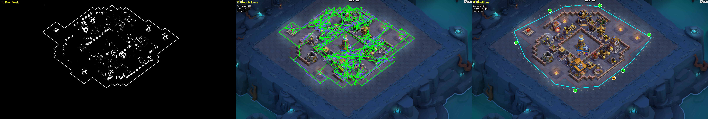
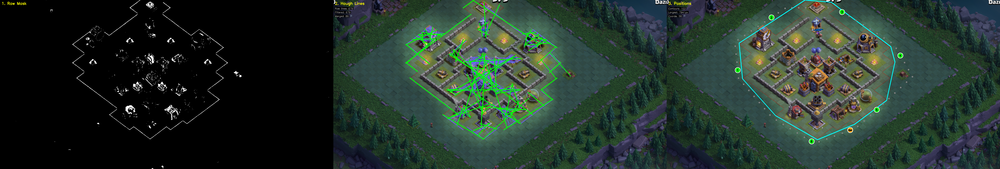
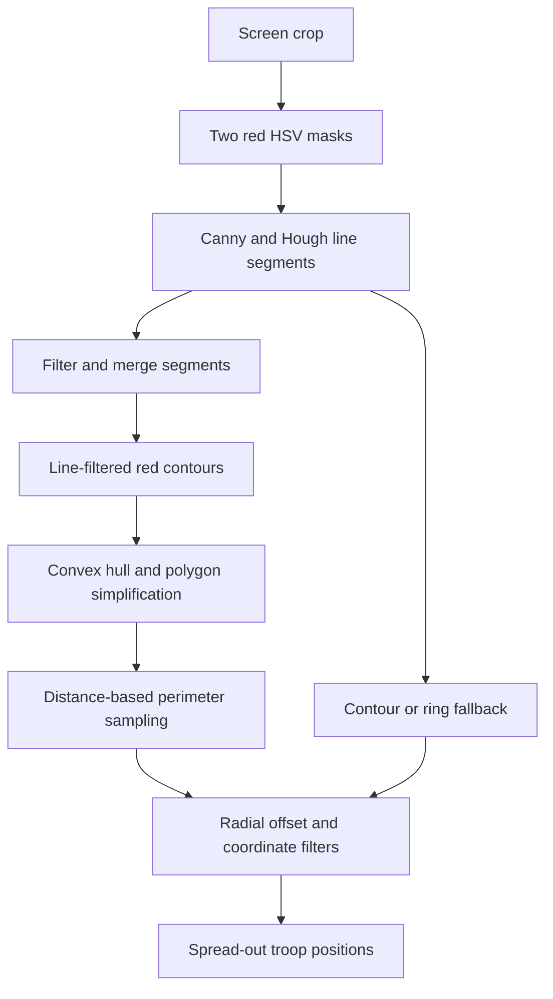

# Computer vision: from pixels to deployment positions

[Project overview](../README.md) · [Implementation](../main.py)

Builder Base boundary detection was one of the parts I struggled with most. The goal was to place troops around the visible deployment boundary instead of relying only on fixed coordinates. That required turning noisy screen pixels into a useful geometric approximation, then turning that geometry into candidate clicks.

## Builder Base diagnostic examples

Boundary detection was difficult because the red mask captures more than the deployment boundary. These two captures show the intermediate detections alongside the selected troop positions on different base layouts.

### Compact layout

The left panel retains the outer boundary but also many pixels from buildings inside it. The middle panel shows numerous interior line candidates: Hough detection alone does not distinguish a deployment boundary from other straight features. The right panel overlays a cyan hull and the selected deployment positions around the compact layout.

### Elongated layout

This layout has a different aspect ratio, with the upper part reaching the capture edge. The displayed hull follows a more elongated envelope. It illustrates why adapting positions to detected geometry is useful, and why capture bounds and missing boundary sections matter.

### Reading the panels

| Panel | Meaning |
|---|---|
| Raw mask | Pixels accepted by the red HSV thresholds; includes boundary fragments and unrelated visual features. |
| Hough lines | Raw segments in blue and merged segments in green. These are candidates, not confirmed boundary edges. |
| Positions | Cyan reconstructed hull, gray candidate points, six numbered green Baby Dragon positions, and the orange Battle Machine position. |

Click either image to inspect the full-resolution capture. The examples illustrate the diagnostic output; they do not establish whether every selected position produced a successful deployment.

### How the diagnostic view relates to the decision

The numbered positions are supplied by the deployment routine. However, `save_bb_dragon_debug_visualization` takes a fresh screenshot and reconstructs the cyan hull from the largest contour in a dilated red mask. The live detector can instead build its hull from multiple Hough-filtered contours or use a fallback. Consequently, the displayed polygon is not necessarily the exact polygon that produced those positions, and the scene may be from a slightly later frame.

The `bb_gold_dragon_debug_positions` setting saves these three-panel views under `screenshots/debug/bb_deployment_zone/`. The separate [F3 debug utility](../tools/debug/debug_bb_deployment_zone.py) contains an older contour/circularity approach and different sampling logic.

An improvement would be to pass the original frame, intermediate masks, chosen hull, and coordinates from one detector invocation to the renderer. That would make the panels an exact trace of a single decision.

## Builder Base: recovering the deployment boundary

The advanced detector is used by the BB Gold Baby Dragon routine. Other Builder Base routines also use a simpler red-mask bounding rectangle, so the convex-hull method is not the only deployment algorithm in the project.

### 1. Isolate red pixels

The bot zooms out and captures a configured screen region. It converts the image to HSV and combines two hue ranges for red, covering both ends of the hue scale. Saturation and brightness thresholds reject some unrelated pixels.

Color alone is insufficient: buildings and decorations can also be red, while the boundary can appear fragmented. The next stages add geometric evidence.

### 2. Find and merge boundary-like lines

`detect_hough_lines` applies Canny edge detection, slight dilation, and a probabilistic Hough transform. Short segments are filtered. The merge routine groups nearby segments using angle similarity, perpendicular distance, and endpoint proximity, then represents a group by its most distant endpoints.

The merged lines create a mask that retains nearby red pixels. Additional dilation connects fragments before contour extraction. This is a heuristic for preferring long boundary-like structures over isolated red objects; it does not classify buildings semantically.

### 3. Construct a convex hull

The detector combines the filtered contour points and calls `cv2.convexHull`. It simplifies the result with `cv2.approxPolyDP`, using a tolerance of 1% of the hull perimeter.

The hull bridges gaps and gives the next stage a closed polygon. It also discards concavities: it approximates an outer envelope rather than recovering the exact legal deployment region. A stray red structure can pull a hull vertex outward.

### 4. Sample the perimeter and offset candidates

The code calculates cumulative edge lengths, samples by distance along the perimeter, and interpolates between vertices. This distributes candidates along edges instead of only choosing polygon corners. The nominal interval is 50 pixels, with at least eight samples.

Each point is shifted 25 pixels along the direction from the capture-region center to the point. This is a radial offset, not a constant-distance offset along each edge's outward normal. The distinction matters when the base is off-center or an edge is oblique.

Candidates are converted back to screen coordinates, checked against a dilated red mask, filtered around the unit bar, and clamped to the configured screen bounds. The mask check excludes pixels near red lines; it is not a filled-polygon test proving that every candidate is outside the base. Clamping and fallback points also mean these are candidate positions, not guaranteed legal clicks.

### 5. Choose troop positions and fall back when needed

The Baby Dragon routine selects six spread-out positions from the candidates. The selector attempts a minimum separation, relaxes it if necessary, and finally falls back to basic spacing. A separate candidate is selected for the Battle Machine where possible.

When line detection is insufficient, the advanced detector tries contours directly: a sufficiently large contour, or a combination of significant contours. If it cannot recover useful geometry, it generates ring positions. This keeps the routine moving, but the fallback carries less information about the actual boundary.

## Building recognition

Building and interface detection uses normalized template correlation (`TM_CCOEFF_NORMED`) with reference images. Multiple templates cover appearance variants. Building-specific thresholds control acceptance, and distance-based duplicate filtering prevents nearby matches from being counted repeatedly in the relevant detection routines.

Debug overlays can show weaker matches alongside accepted detections. That makes threshold choices inspectable: raising a threshold may remove false positives while also missing partially obscured buildings. A match score measures visual similarity, not the probability that a building was correctly identified.

## Spatial clustering for spell placement

Clumps mode groups detected buildings to find opportunities to hit several targets with one spell volley. It converts bounding-box origins into centers using configured building dimensions, then processes detections in confidence order. A building can join a group only if it is within 125 pixels of every existing member. This prevents a chain of nearby buildings from stretching a group across the base.

The algorithm greedily assigns each building to one group, selects the largest group, and averages its centers to choose a casting point. Achievement Farm then casts one Earthquake and ten Lightning spells around that point. When no multi-building group is found, the configured building-priority list determines the target.

This favors the number of nearby targets, rather than explicitly optimizing damage or modelling spell coverage. Assignment depends on confidence order and can miss a larger feasible group. The distance threshold and centroid are heuristics; they do not guarantee that every building is hit.

## Giant Arrow trajectory estimation

The detector gathers bright cyan/green glow segments across multiple frames and filters candidates by color, area, shape, and position. It forms connected groups of nearby points, then scores groups by point count and deviation from a fitted line. A larger group with a more linear arrangement receives a higher score.

For the selected group, the code fits a line and removes points more than 50 pixels away, repeating for up to three passes. It fits either `y` from `x` or `x` from `y` according to the dominant spatial extent, accommodating near-vertical paths. The final segment must be at least 200 pixels long; the endpoint is then extended by 30% for coverage.

When glow detection fails, a fallback estimates the path from purple health-bar detections, filtered by size, shape, and screen position. These are calibrated heuristics: unrelated effects can resemble the trail, and a health bar does not by itself prove that a building was hit by the arrow. The multi-frame observations estimate a spatial path rather than projectile speed or direction of travel.

## Reading numeric values

The project includes both Tesseract OCR and a separate template-based digit reader. In the digit path, thresholded image regions are matched against digit templates. Non-maximum suppression removes overlapping candidate boxes, and the retained detections are assembled into a numeric reading.

This is a useful example of combining established image-processing methods with application-specific rules. The code also applies plausibility checks in some resource-reading paths. Those checks can reject obvious errors, but they do not establish that every surviving reading is correct.
