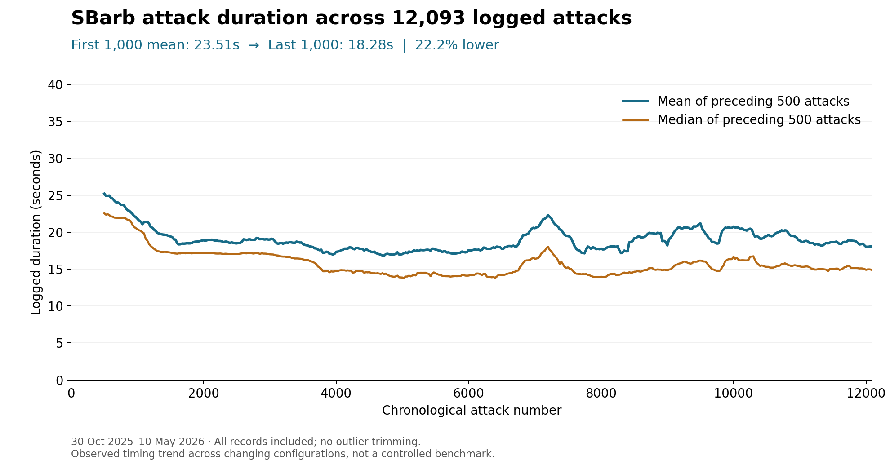

# Attack logs and timing improvements

[Project overview](../README.md)

I kept timing logs while iterating on the bot and optimizing the SBarb attack routine. Across the recorded period, the mean logged duration fell from **23.51 seconds for the first 1,000 attacks to 18.28 seconds for the last 1,000** — a **22.2% reduction**. The corresponding median fell from **21.61 to 14.90 seconds** (31.0%).

## Recorded usage

| Dataset | Logged attacks | Period |
|---|---:|---|
| SBarb | 12,093 | 30 October 2025–10 May 2026 |
| Builder Base Gold | 3,981 | 2 January–9 May 2026 |
| Total | 16,074 | October 2025–May 2026 |

Attack counts come from timestamped records because the loop counter resets between runs. Neither log contains exact duplicate rows or duplicate timestamps.

## SBarb target attainment

The 5,023 SBarb records from 23 January to 10 May 2026 include an outcome: 4,873 are marked Success, 114 Failed (timeout), and 36 Failed (early end). That is 97.0% marked Success among labelled records; the other 7,070 have no outcome field. In the current implementation, Success means the detected destruction percentage reached the configured target, not an independently verified game result.

The building-name field records the selected spell target when the code marks spell completion. It is not independent confirmation that those buildings were destroyed, so I do not use it as a destruction count.

## How the comparison was calculated

All rows were parsed according to their actual width and sorted by timestamp. SBarb records evolved from three columns to four and then five; Builder Base records added a troop-mode column before the timestamp. The initial CSV headers do not describe every later row.

The comparison uses equal-sized first and last windows of 1,000 records, including all logged durations. No slow runs, failures, or statistical outliers were removed. The first window spans 2025-10-30–2025-11-22; the last spans 2026-04-14–2026-05-10. The chart shows a rolling window of 500 attacks, sampled every 25 records plus the final record.

The improvement is overall rather than monotonic: monthly averages increased during some later periods. Comparing the first and last 500 records also gives a reduction, from 25.21s to 18.06s. The [monthly aggregates](metrics/monthly-summary.csv) retain both datasets and all months.

## What the logs measure

In the current code, the SBarb timer starts just before deployment and stops after attack-ending handling. It excludes base search and is not a complete cycle-time or attacks-per-hour measurement. Historical rows do not identify the code revision, so identical timing boundaries across all revisions cannot be verified from these files alone.

Configurations, selected targets, and game conditions can also change. The logs demonstrate an observed reduction during development; they do not isolate how much each code change contributed.

## Builder Base usage

The Builder Base Gold log contains **3,981 attacks** recorded between 2 January and 9 May 2026. It includes 2,963 Baby Dragon attacks, 870 Bomber + Night Witches attacks, and 148 earlier records without a troop-mode field.

I used different strategies and faced opponents of varying strength, with stronger opponents later in the recorded period. Opponent strength was not recorded in the timing logs. These records document the scale and variety of use; they do not provide a controlled optimization benchmark.

The [supporting data table](metrics/builder-base-comparison.csv) groups durations and recorded star outcomes by troop mode and period.
